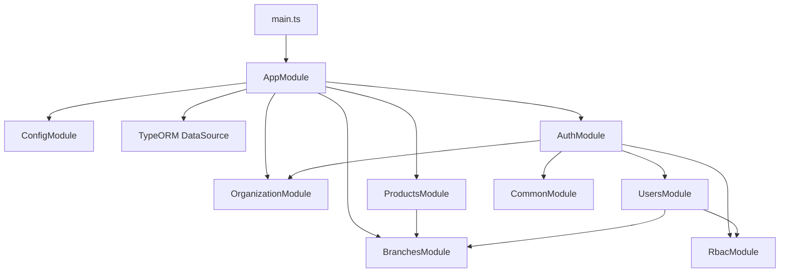
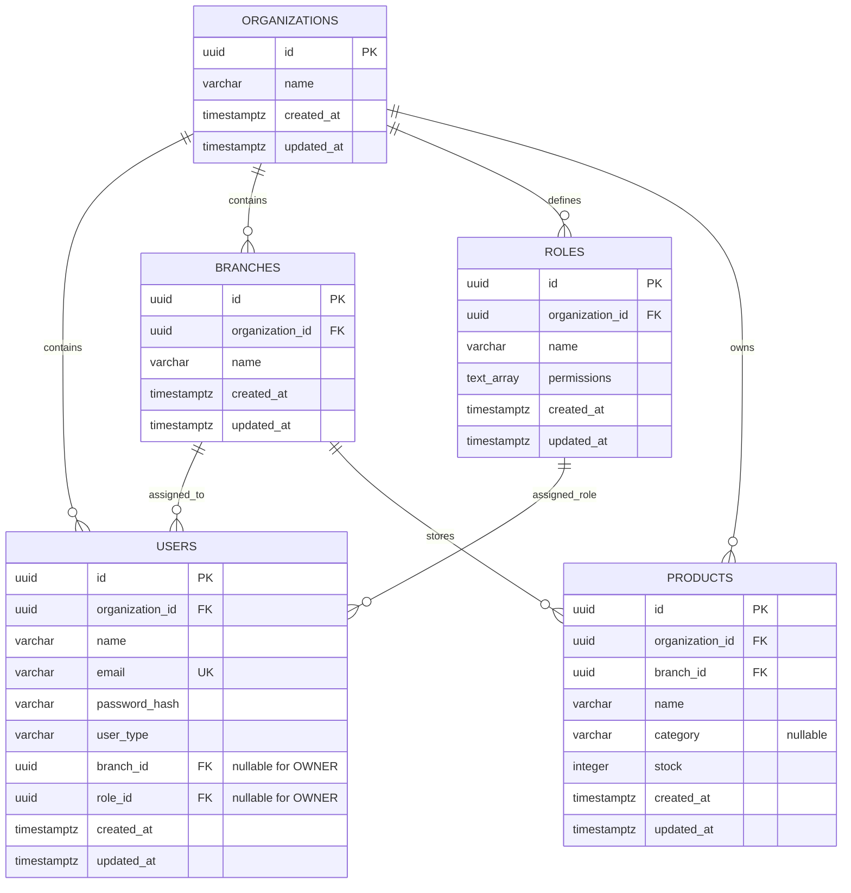

# Branchwork

Branchwork is a multi-tenant, multi-branch organization management backend built with NestJS, TypeScript, PostgreSQL, and TypeORM. It provides organization registration, owner/staff authentication, branch management, organization-defined roles and permissions, staff administration, and branch-scoped product management.

The product concept is a multi-branch organization console. An organization registers, its owner manages branches and staff, and staff members receive access according to the permissions assigned to their role. Staff product access is restricted to their assigned branch.

> **Documentation scope:** This README describes the NestJS backend represented by the supplied source snapshot. The frontend prototype itself is not included in that source snapshot. API examples use illustrative UUIDs and data; replace them with values returned by your own API.

---

## Contents

- [1. Tech Stack and Architecture](#1-tech-stack-and-architecture)
- [2. Entry Points and Execution Flow](#2-entry-points-and-execution-flow)
- [3. Business Logic and Core Workflows](#3-business-logic-and-core-workflows)
- [4. Data Model and Relationships](#4-data-model-and-relationships)
- [5. Authentication and Authorization](#5-authentication-and-authorization)
- [6. API Reference](#6-api-reference)
- [7. Configuration and Environment](#7-configuration-and-environment)
- [8. Run Locally](#8-run-locally)
- [9. Testing](#9-testing)
- [10. External Integrations and Automation](#10-external-integrations-and-automation)
- [11. Risks, Limitations, and Clarifications](#11-risks-limitations-and-clarifications)

---

# 1. Tech Stack and Architecture

## 1.1 Technology stack

| Area | Technology | Responsibility |
|---|---|---|
| Language | TypeScript | Application implementation with strict type checking |
| Runtime | Node.js | Executes the API server |
| Backend framework | NestJS 12 | Modular application structure, dependency injection, controllers, guards |
| HTTP platform | Express via `@nestjs/platform-express` | HTTP request/response handling |
| Database | PostgreSQL | Persistent relational storage |
| ORM | TypeORM | Entity mapping, repositories, query building, transactions |
| Authentication | Passport, `passport-jwt`, `@nestjs/jwt` | JWT bearer-token authentication |
| Password security | bcrypt | Password hashing and comparison |
| Validation | `class-validator`, `class-transformer` | Request validation and input transformation |
| API documentation | `@nestjs/swagger` | OpenAPI document and Swagger UI |
| Configuration | `@nestjs/config` | Environment-variable loading and typed configuration access |
| Testing | Jest, `ts-jest`, `@nestjs/testing` | Service unit tests |
| Linting | Oxlint | TypeScript linting |
| Formatting | Prettier | Source formatting |

The exact dependency versions are maintained in `package.json`.

## 1.2 Architecture pattern

Branchwork uses a **modular monolith with a layered structure**.

- **Modular monolith:** one NestJS application process hosts the business modules.
- **Controller layer:** maps HTTP routes to application operations and shapes HTTP responses.
- **Service layer:** contains business rules, access constraints, validation beyond DTO validation, and error mapping.
- **Repository layer:** performs persistence operations through TypeORM.
- **Schema/entity layer:** defines PostgreSQL tables, columns, relations, indexes, and constraints.
- **Cross-cutting layer:** contains shared authentication metadata, permission constants, helpers, and services.

There is no evidence in the supplied source of independently deployed microservices, message brokers, background workers, or a separate scheduler.

## 1.3 Complete `src/` tree

The following tree reflects the supplied project structure. Empty directories are shown because they exist in the supplied tree; their presence does not imply that a feature has been implemented there.

```text
src/
├── app.module.ts
├── main.ts
├── common/
│   ├── common.module.ts
│   ├── constants/
│   │   └── permissions.constants.ts
│   ├── decorators/
│   │   └── noLeadingSpecialChars.ts                      
│   ├── helpers/
│   │   ├── error.helper.ts
│   │   └── validation.helper.ts
│   ├── interceptors/                
│   ├── interfaces/
│   │   ├── jwt-payload.interface.ts
│   │   ├── pagination.interface.ts
│   │   └── request-user.interface.ts
│   ├── request-metadata/
│   │   └── getUser.decorator.ts
│   └── services/
│       ├── crypto.service.ts
│       ├── crypto.service.spec.ts
│       ├── transaction.service.ts
│       └── transaction.service.spec.ts
├── config/
│   ├── database.config.ts
│   ├── jwt.config.ts
│   └── swagger.config.ts
├── modules/
│   ├── auth/
│   │   ├── auth.controller.ts
│   │   ├── auth.module.ts
│   │   ├── auth.service.ts
│   │   ├── auth.service.spec.ts
│   │   ├── rbac-admin.controller.ts
│   │   ├── rbac-admin.service.ts
│   │   ├── rbac-admin.service.spec.ts
│   │   ├── rbac.module.ts
│   │   ├── rbac.repository.ts
│   │   ├── rbac.service.ts
│   │   ├── rbac.service.spec.ts
│   │   ├── decorators/
│   │   │   ├── auth.decorator.ts
│   │   │   └── permissions.decorator.ts
│   │   ├── dto/
│   │   │   ├── create-role.dto.ts
│   │   │   ├── login.dto.ts
│   │   │   ├── register.dto.ts
│   │   │   ├── role-response.dto.ts
│   │   │   └── update-role.dto.ts
│   │   ├── guards/
│   │   │   ├── access.guard.ts
│   │   │   └── jwt-auth.guard.ts
│   │   └── strategies/
│   │       └── jwt.strategy.ts
│   ├── branches/
│   │   ├── branches.controller.ts
│   │   ├── branches.module.ts
│   │   ├── branches.repository.ts
│   │   ├── branches.service.ts
│   │   ├── branches.service.spec.ts
│   │   └── dto/
│   │       ├── branch-response.dto.ts
│   │       ├── create-branch.dto.ts
│   │       └── update-branch.dto.ts
│   ├── organization/
│   │   ├── organization.controller.ts
│   │   ├── organization.module.ts
│   │   ├── organization.repository.ts
│   │   ├── organization.service.ts
│   │   ├── organization.service.spec.ts
│   │   └── dto/
│   │       └── organization-response.dto.ts
│   ├── products/
│   │   ├── products.controller.ts
│   │   ├── products.module.ts
│   │   ├── products.repository.ts
│   │   ├── products.service.ts
│   │   ├── products.service.spec.ts
│   │   └── dto/
│   │       ├── create-product.dto.ts
│   │       ├── organize-product.dto.ts
│   │       ├── product-query.dto.ts
│   │       └── product-response.dto.ts
│   └── users/
│       ├── users.controller.ts
│       ├── users.module.ts
│       ├── users.repository.ts
│       ├── users.service.ts
│       ├── users.service.spec.ts
│       └── dto/
│           ├── create-staff.dto.ts
│           ├── staff-query.dto.ts
│           ├── update-staff.dto.ts
│           └── user-response.dto.ts
└── schemas/
    ├── Branch.schema.ts
    ├── Organization.schema.ts
    ├── Product.schema.ts
    ├── Role.schema.ts
    └── User.schema.ts
```

## 1.4 Directory responsibilities

| Path | Responsibility |
|---|---|
| `src/main.ts` | Creates the Nest application, applies global HTTP settings, configures Swagger, and starts listening |
| `src/app.module.ts` | Root module; loads configuration, initializes TypeORM, and imports feature modules |
| `src/common/` | Shared utilities and cross-cutting services |
| `src/common/constants/` | Permission identifiers and the permission catalog |
| `src/common/decorators/` | Custom validation decorator for names |
| `src/common/helpers/` | Database-error mapping and input transformation helpers |
| `src/common/interfaces/` | JWT payload, pagination, and authenticated-request user types |
| `src/common/request-metadata/` | `@GetUser()` decorator for reading the authenticated user from the request |
| `src/common/services/` | Password hashing/comparison and transaction wrapper |
| `src/config/` | Database, JWT, and Swagger configuration |
| `src/modules/auth/` | Registration, login, JWT strategy/guard, authorization guard, and role administration |
| `src/modules/branches/` | Branch CRUD and organization-scoped branch persistence |
| `src/modules/organization/` | Current organization lookup and organization persistence |
| `src/modules/products/` | Product CRUD/organization, branch scoping, and pagination |
| `src/modules/users/` | Owner/staff persistence and staff administration |
| `src/schemas/` | TypeORM entity definitions for PostgreSQL tables |

## 1.5 Module dependency overview



The module graph above describes Nest module composition and service dependencies, not separate processes.

---

# 2. Entry Points and Execution Flow

## 2.1 Application entry point

The application starts at `src/main.ts`:

```ts
async function bootstrap(): Promise<void> {
  const app = await NestFactory.create(AppModule);

  app.setGlobalPrefix('api');
  app.enableCors();

  app.useGlobalPipes(
    new ValidationPipe({
      whitelist: true,
      forbidNonWhitelisted: true,
      transform: true,
    }),
  );

  setupSwagger(app);

  const port = process.env.PORT ?? 3000;
  await app.listen(port);
}

void bootstrap();
```

## 2.2 Startup sequence

1. `NestFactory.create(AppModule)` creates the Nest application.
2. `ConfigModule.forRoot()` loads `.env`, or `.env.test` when `NODE_ENV=test`.
3. Database and JWT configuration factories are registered.
4. `TypeOrmModule.forRootAsync()` reads the database configuration and initializes PostgreSQL connectivity.
5. The root module imports the organization, branch, authentication, and product modules. The authentication module imports the users and RBAC modules.
6. Global HTTP settings are applied:
   - `/api` global route prefix
   - CORS enabled
   - request DTO validation and transformation
7. Swagger is registered at `/api/docs`.
8. The server listens on `PORT`, or `3000` when `PORT` is not set.

The global validation pipe strips no unknown input silently: `whitelist: true` and `forbidNonWhitelisted: true` mean unexpected request properties are rejected. `transform: true` enables DTO transformation, including numeric query/body conversions defined by DTOs.

## 2.3 Processes and communication

The supplied application is one API server process backed by PostgreSQL. No separate worker, scheduler, bot, queue consumer, or automation process is shown in the supplied source.

---

# 3. Business Logic and Core Workflows

## 3.1 Organization registration

1. A visitor sends organization name, owner name, email, and password to `POST /api/auth/register`.
2. The password is hashed using bcrypt.
3. A database transaction creates the organization and its owner user.
4. A JWT is generated after the transaction succeeds.
5. The API returns the token and safe owner profile fields. The password/hash is not returned.

The organization and owner creation are atomic: if the transaction fails, neither should be committed.

## 3.2 Owner login and profile

1. The user sends email and password to `POST /api/auth/login`.
2. Email is normalized to lowercase.
3. The stored password hash is loaded explicitly for authentication and compared with bcrypt.
4. A JWT is returned when credentials are valid.
5. `GET /api/auth/me` returns the authenticated user's profile. For staff, the profile includes the assigned role name and role permissions.

## 3.3 Branch management

The owner can create, list, view, update, and delete branches. Branch names are unique within an organization. Branch lookup and mutation are scoped by the authenticated organization.

Staff may view branches only when their role includes `branch.view`. Branch creation, update, and deletion are owner-only.

## 3.4 Role and permission management

The owner can:
- Retrieve the permission catalog.
- Create a role.
- List organization roles.
- View a role.
- Update a role's name and/or permissions.
- Delete a role when no staff member is assigned to it.

Permissions are stored as a PostgreSQL `text[]` column on the role. They are not represented by a separate permissions table.

A role may have no permissions. However, `product.organize` cannot be assigned unless `product.view` is also assigned.

## 3.5 Staff management

The owner creates staff with a name, email, password, branch ID, and role ID. The service checks that both the branch and role belong to the authenticated organization, hashes the password, and stores the staff account.

Staff can view staff lists and staff details only when their role includes `staff.view`. Staff list/detail queries are restricted to the requester's branch. The owner can list and manage staff across the organization.

The owner can update staff name, branch, and/or role, and delete staff. A staff account must retain both a branch and a role.

## 3.6 Product management

- The owner creates and deletes products.
- Owners and staff with `product.view` can list and view products.
- Owners can optionally filter products by a branch.
- Staff product list/detail queries are always restricted to their assigned branch.
- Staff with both `product.view` and `product.organize` can change product category, stock, and branch.
- A destination branch must belong to the same organization.
- Product stock cannot be negative.

**Important:** staff branch visibility is enforced in the service/repository query path. A staff member's supplied `branchId` query parameter does not override their assigned branch.

---

# 4. Data Model and Relationships

## 4.1 Entity relationship diagram



## 4.2 Relationship summary

| Parent | Child | Cardinality | Meaning |
|---|---|---|---|
| `organizations` | `branches` | One-to-many | An organization owns multiple branches |
| `organizations` | `users` | One-to-many | An organization contains owner/staff user records |
| `organizations` | `roles` | One-to-many | Roles are defined within an organization |
| `organizations` | `products` | One-to-many | Products belong to an organization |
| `branches` | `users` | One-to-many | Staff users may be assigned to a branch; owner branch is null |
| `branches` | `products` | One-to-many | Products are assigned to a branch |
| `roles` | `users` | One-to-many | Staff users are assigned a role; owner role is null |

## 4.3 Table details and constraints

### `organizations`

- `id`: UUID primary key.
- `name`: `varchar(100)`.
- `created_at`, `updated_at`: timezone-aware timestamps.

### `branches`

- `id`: UUID primary key.
- `organization_id`: required FK to `organizations.id`.
- `name`: `varchar(100)`.
- Unique constraint: `(organization_id, name)`.
- Organization deletion is restricted while dependent branch records exist.

### `roles`

- `id`: UUID primary key.
- `organization_id`: required FK to `organizations.id`.
- `name`: `varchar(100)`.
- `permissions`: PostgreSQL `text[]`, default empty array.
- Unique constraint: `(organization_id, name)`.
- Organization deletion is restricted while dependent roles exist.

### `users`

- `id`: UUID primary key.
- `organization_id`: required FK to `organizations.id`.
- `name`: `varchar(100)`.
- `email`: `varchar(255)`, globally unique and lowercase.
- `password_hash`: `varchar(255)` and excluded from normal TypeORM selects (`select: false`).
- `user_type`: `OWNER` or `STAFF`.
- `branch_id`: nullable FK to `branches.id`.
- `role_id`: nullable FK to `roles.id`.
- Check constraint enforces:
  - `OWNER` has null `branch_id` and null `role_id`.
  - `STAFF` has non-null `branch_id` and non-null `role_id`.
- Index: `(organization_id, branch_id)`.
- Foreign-key deletion behavior is `RESTRICT`.

### `products`

- `id`: UUID primary key.
- `organization_id`: required FK to `organizations.id`.
- `branch_id`: required FK to `branches.id`.
- `name`: `varchar(100)`.
- `category`: nullable `varchar(50)`.
- `stock`: integer, default `0`.
- Check constraint: `stock >= 0`.
- Index: `(organization_id, branch_id)`.
- Foreign-key deletion behavior is `RESTRICT`.

## 4.4 Data validation and persistence

- DTOs validate incoming body and query data with `class-validator`.
- `class-transformer` trims strings, lowercases emails, and converts numeric query/body values where configured.
- The global validation pipe rejects unknown properties.
- Services enforce organization ownership and branch scoping before repository operations.
- Repositories use TypeORM repositories/query builders.
- `TransactionService` wraps TypeORM's `DataSource.transaction()` for atomic work.
- `CryptoService` hashes and verifies passwords with bcrypt (10 salt rounds).

## 4.5 Tenant-boundary note

The services validate that staff branch/role assignments and product branch assignments belong to the same organization. However, the entity definitions show separate foreign keys for `organization_id`, `branch_id`, and `role_id`; they do not define composite foreign keys that independently guarantee those tenant relationships at the database constraint level. Keep the service-level ownership checks in place, and consider composite constraints if stronger database-level tenant integrity is required.

---

# 5. Authentication and Authorization

## 5.1 JWT authentication

- Tokens are sent using the HTTP `Authorization` header.
- The expected format is `Authorization: Bearer <accessToken>`.
- JWT payload contains `sub`, the authenticated user UUID.
- `JwtStrategy` validates the token signature/expiry, reloads the user, and builds request identity from current database values.
- JWT expiration is configured by `JWT_EXPIRES_IN`, defaulting to `1h`.

## 5.2 Access levels

| Access decorator | Meaning |
|---|---|
| `@Public()` | Does not require a JWT |
| `@Authenticated()` | Requires a valid JWT |
| `@OwnerOnly()` | Requires a valid JWT and `userType === OWNER` |
| `@RequirePermissions(...)` | Requires a valid JWT and every listed permission; owners bypass permission checks |

The JWT guard and access guard are registered globally through `APP_GUARD`.

## 5.3 Permission catalog

| Permission | Grants |
|---|---|
| `product.view` | View products |
| `product.organize` | Organize products; must be combined with `product.view` |
| `branch.view` | View branches |
| `staff.view` | View staff lists and staff details |

A request decorated with multiple permissions requires **all** of them, not just one.

## 5.4 Role matrix

| Operation | Owner | Staff |
|---|---:|---:|
| Register organization | Public registration flow | — |
| View current organization | Yes | Yes |
| Create/update/delete branches | Yes | No |
| View branches | Yes | `branch.view` |
| Create/update/delete roles | Yes | No |
| View roles and permission catalog | Yes | No |
| Create/update/delete staff | Yes | No |
| View staff | Yes | `staff.view` |
| Create/delete products | Yes | No |
| View products | Yes | `product.view` |
| Organize products | Yes | `product.view` + `product.organize` |

---

# 6. API Reference

## 6.1 Base URL and request conventions

Local base URL:

```text
http://localhost:3000/api
```

Swagger UI:

```text
http://localhost:3000/api/docs
```

For JSON requests, use:

```http
Content-Type: application/json
```

For protected endpoints, also use:

```http
Authorization: Bearer <accessToken>
```

All `:id` route parameters shown below are UUIDs and are validated with `ParseUUIDPipe`.

### Standard error response examples

NestJS exception responses generally use the following structure. Exact validation messages depend on the invalid field/value.

```json
{
  "statusCode": 400,
  "message": ["name must be longer than or equal to 1 characters"],
  "error": "Bad Request"
}
```

Typical authentication/authorization responses:

```json
{
  "statusCode": 401,
  "message": "Authentication is required.",
  "error": "Unauthorized"
}
```

```json
{
  "statusCode": 403,
  "message": "You do not have permission to perform this action.",
  "error": "Forbidden"
}
```

A missing resource typically returns `404 Not Found`. A duplicate or database constraint conflict typically returns `409 Conflict`.

## 6.2 Authentication endpoints

### 1. Register an organization and owner

`POST /api/auth/register`

- Access: Public.
- Purpose: Creates an organization and its owner in one transaction, then returns a JWT.
- Body:

```json
{
  "organizationName": "Branchwork Technologies",
  "name": "Maheed Ahammed",
  "email": "owner@example.com",
  "password": "StrongPassword123"
}
```

- Success: `201 Created` (NestJS default for `POST`).

Example response:

```json
{
  "accessToken": "<jwt-token>",
  "user": {
    "id": "11111111-1111-4111-8111-111111111111",
    "organizationId": "22222222-2222-4222-8222-222222222222",
    "name": "Maheed Ahammed",
    "email": "owner@example.com",
    "userType": "OWNER"
  }
}
```

Relevant errors:
- `400`: invalid DTO data.
- `409`: duplicate email or database uniqueness conflict.

### 2. Login

`POST /api/auth/login`

- Access: Public.
- Body:

```json
{
  "email": "owner@example.com",
  "password": "StrongPassword123"
}
```

- Success: `201 Created` (NestJS default for `POST`).

Example response:

```json
{
  "accessToken": "<jwt-token>",
  "user": {
    "id": "11111111-1111-4111-8111-111111111111",
    "organizationId": "22222222-2222-4222-8222-222222222222",
    "name": "Maheed Ahammed",
    "email": "owner@example.com",
    "userType": "OWNER"
  }
}
```

Relevant errors:
- `400`: invalid DTO data.
- `401`: `Invalid email or password.`

### 3. Get the authenticated user's profile

`GET /api/auth/me`

- Access: Authenticated owner or staff.
- Headers: `Authorization: Bearer <accessToken>`.
- Body: None.
- Success: `200 OK`.

Owner example:

```json
{
  "id": "11111111-1111-4111-8111-111111111111",
  "organizationId": "22222222-2222-4222-8222-222222222222",
  "userType": "OWNER",
  "name": "Maheed Ahammed",
  "branchId": null,
  "roleName": null,
  "permissions": [
    "product.view",
    "product.organize",
    "branch.view",
    "staff.view"
  ]
}
```

Staff example:

```json
{
  "id": "33333333-3333-4333-8333-333333333333",
  "organizationId": "22222222-2222-4222-8222-222222222222",
  "userType": "STAFF",
  "name": "John Doe",
  "branchId": "44444444-4444-4444-8444-444444444444",
  "roleName": "Stock Clerk",
  "permissions": [
    "product.view",
    "product.organize"
  ]
}
```

Relevant errors:
- `401`: missing/invalid/expired token or deleted account.
- `403`: staff account has no assigned role.

## 6.3 Organization endpoints

### 4. Get the current organization

`GET /api/organization/me`

- Access: Authenticated owner or staff.
- Headers: `Authorization: Bearer <accessToken>`.
- Body: None.
- Success: `200 OK`.

Example response:

```json
{
  "id": "22222222-2222-4222-8222-222222222222",
  "name": "Branchwork Technologies",
  "createdAt": "2026-11-17T10:00:00.000Z",
  "updatedAt": "2026-11-17T10:00:00.000Z"
}
```

Relevant errors:
- `401`: authentication required.
- `404`: organization not found.

## 6.4 Branch endpoints

### 5. Create a branch

`POST /api/branches`

- Access: Owner only.
- Body:

```json
{
  "name": "Dhanmondi Branch"
}
```

- Success: `201 Created`.

Example response:

```json
{
  "id": "44444444-4444-4444-8444-444444444444",
  "name": "Dhanmondi Branch",
  "organizationId": "22222222-2222-4222-8222-222222222222",
  "createdAt": "2026-11-17T10:10:00.000Z",
  "updatedAt": "2026-11-17T10:10:00.000Z"
}
```

Relevant errors:
- `400`: invalid name.
- `401`: authentication required.
- `403`: owner access required.
- `409`: branch name already exists in the organization.

### 6. List organization branches

`GET /api/branches`

- Access: Owner, or staff with `branch.view`.
- Body: None.
- Success: `200 OK`.

Example response:

```json
[
  {
    "id": "44444444-4444-4444-8444-444444444444",
    "name": "Dhanmondi Branch",
    "organizationId": "22222222-2222-4222-8222-222222222222",
    "createdAt": "2026-11-17T10:10:00.000Z",
    "updatedAt": "2026-11-17T10:10:00.000Z"
  },
  {
    "id": "55555555-5555-4555-8555-555555555555",
    "name": "Gulshan Branch",
    "organizationId": "22222222-2222-4222-8222-222222222222",
    "createdAt": "2026-11-17T10:15:00.000Z",
    "updatedAt": "2026-11-17T10:15:00.000Z"
  }
]
```

Relevant errors:
- `401`: authentication required.
- `403`: missing `branch.view`.

### 7. Get a branch by ID

`GET /api/branches/:id`

- Access: Owner, or staff with `branch.view`.
- Example: `GET /api/branches/44444444-4444-4444-8444-444444444444`
- Body: None.
- Success: `200 OK`.

Example response:

```json
{
  "id": "44444444-4444-4444-8444-444444444444",
  "name": "Dhanmondi Branch",
  "organizationId": "22222222-2222-4222-8222-222222222222",
  "createdAt": "2026-11-17T10:10:00.000Z",
  "updatedAt": "2026-11-17T10:10:00.000Z"
}
```

Relevant errors:
- `400`: malformed UUID.
- `401`: authentication required.
- `403`: missing `branch.view`.
- `404`: branch not found in the authenticated organization.

### 8. Update a branch

`PATCH /api/branches/:id`

- Access: Owner only.
- Example: `PATCH /api/branches/44444444-4444-4444-8444-444444444444`
- Body:

```json
{
  "name": "Dhanmondi Main Branch"
}
```

- Success: `200 OK`.

Example response:

```json
{
  "id": "44444444-4444-4444-8444-444444444444",
  "name": "Dhanmondi Main Branch",
  "organizationId": "22222222-2222-4222-8222-222222222222",
  "createdAt": "2026-11-17T10:10:00.000Z",
  "updatedAt": "2026-11-17T10:30:00.000Z"
}
```

Relevant errors:
- `400`: invalid or empty update.
- `401`: authentication required.
- `403`: owner access required.
- `404`: branch not found.
- `409`: duplicate branch name.

### 9. Delete a branch

`DELETE /api/branches/:id`

- Access: Owner only.
- Example: `DELETE /api/branches/44444444-4444-4444-8444-444444444444`
- Body: None.
- Success: `200 OK`.

Example response:

```json
{
  "message": "Branch has been deleted successfully."
}
```

Relevant errors:
- `400`: malformed UUID.
- `401`: authentication required.
- `403`: owner access required.
- `404`: branch not found.
- `409`: branch is referenced by staff or products and cannot be deleted.

## 6.5 Role and permission endpoints

All role endpoints are owner-only, including the permission catalog.

### 10. Create a role

`POST /api/roles`

- Access: Owner only.
- Body:

```json
{
  "name": "Branch Manager",
  "permissions": [
    "product.view",
    "product.organize",
    "branch.view",
    "staff.view"
  ]
}
```

- Success: `201 Created`.

Example response:

```json
{
  "id": "66666666-6666-4666-8666-666666666666",
  "organizationId": "22222222-2222-4222-8222-222222222222",
  "name": "Branch Manager",
  "permissions": [
    "product.view",
    "product.organize",
    "branch.view",
    "staff.view"
  ],
  "createdAt": "2026-11-17T10:40:00.000Z",
  "updatedAt": "2026-11-17T10:40:00.000Z"
}
```

Relevant errors:
- `400`: invalid permission, duplicate permission in the array, or `product.organize` without `product.view`.
- `401`: authentication required.
- `403`: owner access required.
- `409`: role name already exists in the organization.

### 11. Get the permission catalog

`GET /api/roles/permissions`

- Access: Owner only.
- Body: None.
- Success: `200 OK`.

Example response:

```json
[
  "product.view",
  "product.organize",
  "branch.view",
  "staff.view"
]
```

### 12. List organization roles

`GET /api/roles`

- Access: Owner only.
- Body: None.
- Success: `200 OK`.

Example response:

```json
[
  {
    "id": "66666666-6666-4666-8666-666666666666",
    "organizationId": "22222222-2222-4222-8222-222222222222",
    "name": "Branch Manager",
    "permissions": [
      "product.view",
      "product.organize",
      "branch.view",
      "staff.view"
    ],
    "createdAt": "2026-11-17T10:40:00.000Z",
    "updatedAt": "2026-11-17T10:40:00.000Z"
  }
]
```

### 13. Get a role by ID

`GET /api/roles/:id`

- Access: Owner only.
- Example: `GET /api/roles/66666666-6666-4666-8666-666666666666`
- Body: None.
- Success: `200 OK`.

Example response:

```json
{
  "id": "66666666-6666-4666-8666-666666666666",
  "organizationId": "22222222-2222-4222-8222-222222222222",
  "name": "Branch Manager",
  "permissions": ["product.view", "product.organize"],
  "createdAt": "2026-11-17T10:40:00.000Z",
  "updatedAt": "2026-11-17T10:40:00.000Z"
}
```

Relevant errors:
- `400`: malformed UUID.
- `401`: authentication required.
- `403`: owner access required.
- `404`: role not found in the authenticated organization.

### 14. Update a role

`PATCH /api/roles/:id`

- Access: Owner only.
- Example: `PATCH /api/roles/66666666-6666-4666-8666-666666666666`
- At least one of `name` or `permissions` must be provided.
- Body example:

```json
{
  "name": "Senior Branch Manager",
  "permissions": [
    "product.view",
    "product.organize",
    "branch.view"
  ]
}
```

- Success: `200 OK`.

Example response:

```json
{
  "id": "66666666-6666-4666-8666-666666666666",
  "organizationId": "22222222-2222-4222-8222-222222222222",
  "name": "Senior Branch Manager",
  "permissions": [
    "product.view",
    "product.organize",
    "branch.view"
  ],
  "createdAt": "2026-11-17T10:40:00.000Z",
  "updatedAt": "2026-11-17T11:00:00.000Z"
}
```

Relevant errors:
- `400`: empty update, invalid permission, or `product.organize` without `product.view`.
- `401`: authentication required.
- `403`: owner access required.
- `404`: role not found.
- `409`: duplicate role name.

### 15. Delete a role

`DELETE /api/roles/:id`

- Access: Owner only.
- Example: `DELETE /api/roles/66666666-6666-4666-8666-666666666666`
- Body: None.
- Success: `200 OK`.

Example response:

```json
{
  "message": "Role deleted successfully."
}
```

Relevant errors:
- `400`: malformed UUID.
- `401`: authentication required.
- `403`: owner access required.
- `404`: role not found.
- `409`: role is assigned to staff and cannot be deleted.

## 6.6 Staff endpoints

### 16. Create a staff member

`POST /api/users`

- Access: Owner only.
- Body:

```json
{
  "name": "John Doe",
  "email": "john@example.com",
  "password": "StrongPassword123",
  "branchId": "44444444-4444-4444-8444-444444444444",
  "roleId": "66666666-6666-4666-8666-666666666666"
}
```

- Success: `201 Created`.

Example response:

```json
{
  "id": "33333333-3333-4333-8333-333333333333",
  "organizationId": "22222222-2222-4222-8222-222222222222",
  "name": "John Doe",
  "email": "john@example.com",
  "userType": "STAFF",
  "branchId": "44444444-4444-4444-8444-444444444444",
  "roleId": "66666666-6666-4666-8666-666666666666",
  "createdAt": "2026-11-17T11:10:00.000Z",
  "updatedAt": "2026-11-17T11:10:00.000Z"
}
```

The password and password hash are not returned.

Relevant errors:
- `400`: invalid DTO, malformed branch/role UUID, or invalid values.
- `401`: authentication required.
- `403`: owner access required.
- `404`: branch or role not found in the organization.
- `409`: email already exists.

### 17. List staff members

`GET /api/users?page=1&limit=20`

- Access: Owner, or staff with `staff.view`.
- Query parameters:
  - `page`: integer, default `1`, minimum `1`.
  - `limit`: integer, default `20`, range `1`–`100`.
- Body: None.
- Success: `200 OK`.

Example response:

```json
{
  "items": [
    {
      "id": "33333333-3333-4333-8333-333333333333",
      "organizationId": "22222222-2222-4222-8222-222222222222",
      "name": "John Doe",
      "email": "john@example.com",
      "userType": "STAFF",
      "branchId": "44444444-4444-4444-8444-444444444444",
      "roleId": "66666666-6666-4666-8666-666666666666",
      "createdAt": "2026-11-17T11:10:00.000Z",
      "updatedAt": "2026-11-17T11:10:00.000Z"
    }
  ],
  "meta": {
    "page": 1,
    "limit": 20,
    "total": 1,
    "totalPages": 1
  }
}
```

Owner sees organization staff. Staff sees staff from their own branch only.

Relevant errors:
- `400`: invalid pagination.
- `401`: authentication required.
- `403`: missing `staff.view` or staff account has no branch assignment.

### 18. Get a staff member by ID

`GET /api/users/:id`

- Access: Owner, or staff with `staff.view`.
- Example: `GET /api/users/33333333-3333-4333-8333-333333333333`
- Body: None.
- Success: `200 OK`.

Example response:

```json
{
  "id": "33333333-3333-4333-8333-333333333333",
  "organizationId": "22222222-2222-4222-8222-222222222222",
  "name": "John Doe",
  "email": "john@example.com",
  "userType": "STAFF",
  "branchId": "44444444-4444-4444-8444-444444444444",
  "roleId": "66666666-6666-4666-8666-666666666666",
  "createdAt": "2026-11-17T11:10:00.000Z",
  "updatedAt": "2026-11-17T11:10:00.000Z"
}
```

Staff cannot retrieve a staff member from another branch.

Relevant errors:
- `400`: malformed UUID.
- `401`: authentication required.
- `403`: missing `staff.view`.
- `404`: staff member not found in the requester's organization/branch scope.

### 19. Update a staff member

`PATCH /api/users/:id`

- Access: Owner only.
- Example: `PATCH /api/users/33333333-3333-4333-8333-333333333333`
- At least one field must be supplied.
- Supported fields: `name`, `branchId`, `roleId`.
- Body:

```json
{
  "name": "John Smith",
  "branchId": "55555555-5555-4555-8555-555555555555",
  "roleId": "66666666-6666-4666-8666-666666666666"
}
```

- Success: `200 OK`.

Example response:

```json
{
  "id": "33333333-3333-4333-8333-333333333333",
  "organizationId": "22222222-2222-4222-8222-222222222222",
  "name": "John Smith",
  "email": "john@example.com",
  "userType": "STAFF",
  "branchId": "55555555-5555-4555-8555-555555555555",
  "roleId": "66666666-6666-4666-8666-666666666666",
  "createdAt": "2026-11-17T11:10:00.000Z",
  "updatedAt": "2026-11-17T11:30:00.000Z"
}
```

Relevant errors:
- `400`: empty update, invalid UUID, or missing effective branch/role.
- `401`: authentication required.
- `403`: owner access required.
- `404`: staff member, branch, or role not found.
- `409`: database constraint conflict.

### 20. Delete a staff member

`DELETE /api/users/:id`

- Access: Owner only.
- Example: `DELETE /api/users/33333333-3333-4333-8333-333333333333`
- Body: None.
- Success: `200 OK`.

Example response:

```json
{
  "message": "Staff member has been deleted successfully."
}
```

Relevant errors:
- `400`: malformed UUID.
- `401`: authentication required.
- `403`: owner access required.
- `404`: staff member not found.

## 6.7 Product endpoints

### 21. Create a product

`POST /api/products`

- Access: Owner only.
- Body:

```json
{
  "name": "Wireless Mouse",
  "branchId": "44444444-4444-4444-8444-444444444444",
  "category": "Electronics",
  "stock": 100
}
```

`category` is optional and nullable. `stock` is optional and defaults to `0`.

- Success: `201 Created`.

Example response:

```json
{
  "id": "77777777-7777-4777-8777-777777777777",
  "organizationId": "22222222-2222-4222-8222-222222222222",
  "branchId": "44444444-4444-4444-8444-444444444444",
  "name": "Wireless Mouse",
  "category": "Electronics",
  "stock": 100,
  "createdAt": "2026-11-17T11:45:00.000Z",
  "updatedAt": "2026-11-17T11:45:00.000Z"
}
```

Relevant errors:
- `400`: invalid product data or numeric range.
- `401`: authentication required.
- `403`: owner access required.
- `404`: branch not found in the organization.
- `409`: database constraint conflict.

### 22. List products

`GET /api/products?page=1&limit=20`

Optional owner filter:

`GET /api/products?page=1&limit=20&branchId=44444444-4444-4444-8444-444444444444`

- Access: Owner, or staff with `product.view`.
- Query parameters:
  - `page`: integer, default `1`, minimum `1`.
  - `limit`: integer, default `20`, range `1`–`100`.
  - `branchId`: optional UUID.
- Body: None.
- Success: `200 OK`.

Example response:

```json
{
  "items": [
    {
      "id": "77777777-7777-4777-8777-777777777777",
      "organizationId": "22222222-2222-4222-8222-222222222222",
      "branchId": "44444444-4444-4444-8444-444444444444",
      "name": "Wireless Mouse",
      "category": "Electronics",
      "stock": 100,
      "createdAt": "2026-11-17T11:45:00.000Z",
      "updatedAt": "2026-11-17T11:45:00.000Z"
    }
  ],
  "meta": {
    "page": 1,
    "limit": 20,
    "total": 1,
    "totalPages": 1
  }
}
```

Owners can see all organization products or filter by a branch. Staff are always restricted to their assigned branch; a supplied `branchId` query value does not change that scope.

Relevant errors:
- `400`: invalid pagination or malformed `branchId`.
- `401`: authentication required.
- `403`: missing `product.view`, or staff account has no branch assignment.

### 23. Get a product by ID

`GET /api/products/:id`

- Access: Owner, or staff with `product.view`.
- Example: `GET /api/products/77777777-7777-4777-8777-777777777777`
- Body: None.
- Success: `200 OK`.

Example response:

```json
{
  "id": "77777777-7777-4777-8777-777777777777",
  "organizationId": "22222222-2222-4222-8222-222222222222",
  "branchId": "44444444-4444-4444-8444-444444444444",
  "name": "Wireless Mouse",
  "category": "Electronics",
  "stock": 100,
  "createdAt": "2026-11-17T11:45:00.000Z",
  "updatedAt": "2026-11-17T11:45:00.000Z"
}
```

Staff cannot retrieve products outside their assigned branch.

Relevant errors:
- `400`: malformed UUID.
- `401`: authentication required.
- `403`: missing `product.view` or staff account has no branch assignment.
- `404`: product not found in the requester's organization/branch scope.

### 24. Organize a product

`PATCH /api/products/:id/organize`

- Access: Owner, or staff with **both** `product.view` and `product.organize`.
- At least one field must be provided.
- Supported fields: `category`, `stock`, `branchId`.
- Body example:

```json
{
  "category": "Accessories",
  "stock": 75,
  "branchId": "55555555-5555-4555-8555-555555555555"
}
```

- Success: `200 OK`.

Example response:

```json
{
  "id": "77777777-7777-4777-8777-777777777777",
  "organizationId": "22222222-2222-4222-8222-222222222222",
  "branchId": "55555555-5555-4555-8555-555555555555",
  "name": "Wireless Mouse",
  "category": "Accessories",
  "stock": 75,
  "createdAt": "2026-11-17T11:45:00.000Z",
  "updatedAt": "2026-11-17T12:00:00.000Z"
}
```

A staff member can organize only a product that is currently in their own branch. The destination branch must belong to the same organization.

Relevant errors:
- `400`: empty update, invalid category/stock/branch UUID, negative stock, or stock outside PostgreSQL integer range.
- `401`: authentication required.
- `403`: missing either required permission or staff has no assigned branch.
- `404`: product or destination branch not found in the organization/branch scope.
- `409`: database constraint conflict.

### 25. Delete a product

`DELETE /api/products/:id`

- Access: Owner only.
- Example: `DELETE /api/products/77777777-7777-4777-8777-777777777777`
- Body: None.
- Success: `200 OK`.

Example response:

```json
{
  "message": "Product has been deleted successfully."
}
```

Relevant errors:
- `400`: malformed UUID.
- `401`: authentication required.
- `403`: owner access required.
- `404`: product not found.

## 6.8 Endpoint inventory

| # | Method | Endpoint | Access |
|---:|---|---|---|
| 1 | `POST` | `/api/auth/register` | Public |
| 2 | `POST` | `/api/auth/login` | Public |
| 3 | `GET` | `/api/auth/me` | Authenticated |
| 4 | `GET` | `/api/organization/me` | Authenticated |
| 5 | `POST` | `/api/branches` | Owner |
| 6 | `GET` | `/api/branches` | Owner or `branch.view` |
| 7 | `GET` | `/api/branches/:id` | Owner or `branch.view` |
| 8 | `PATCH` | `/api/branches/:id` | Owner |
| 9 | `DELETE` | `/api/branches/:id` | Owner |
| 10 | `POST` | `/api/roles` | Owner |
| 11 | `GET` | `/api/roles/permissions` | Owner |
| 12 | `GET` | `/api/roles` | Owner |
| 13 | `GET` | `/api/roles/:id` | Owner |
| 14 | `PATCH` | `/api/roles/:id` | Owner |
| 15 | `DELETE` | `/api/roles/:id` | Owner |
| 16 | `POST` | `/api/users` | Owner |
| 17 | `GET` | `/api/users` | Owner or `staff.view` |
| 18 | `GET` | `/api/users/:id` | Owner or `staff.view` |
| 19 | `PATCH` | `/api/users/:id` | Owner |
| 20 | `DELETE` | `/api/users/:id` | Owner |
| 21 | `POST` | `/api/products` | Owner |
| 22 | `GET` | `/api/products` | Owner or `product.view` |
| 23 | `GET` | `/api/products/:id` | Owner or `product.view` |
| 24 | `PATCH` | `/api/products/:id/organize` | Owner or `product.view` + `product.organize` |
| 25 | `DELETE` | `/api/products/:id` | Owner |

There are **25 controller routes** in the supplied source snapshot.

---

# 7. Configuration and Environment

## 7.1 Environment variables

| Variable | Required? | Default / example | Purpose |
|---|---|---|---|
| `NODE_ENV` | No | `development` | Selects `.env` vs `.env.test` and TypeORM schema behavior |
| `PORT` | No | `3000` | HTTP server port |
| `DB_HOST` | Yes | `localhost` | PostgreSQL host |
| `DB_PORT` | Yes | `5432` | PostgreSQL port; must be an integer from 1 to 65535 |
| `DB_USER` | Yes | `postgres` | PostgreSQL username |
| `DB_PASSWORD` | Yes | Replace placeholder | PostgreSQL password |
| `DB_NAME` | Yes | `branchwork` | PostgreSQL database name |
| `JWT_SECRET` | Yes | Replace placeholder with a strong secret | JWT signing/verification secret |
| `JWT_EXPIRES_IN` | No | `1h` | JWT lifetime; accepted examples include `15m`, `1h`, `7d` |

The required database variables are validated at startup. `JWT_SECRET` is required. `JWT_EXPIRES_IN` defaults to `1h` and is validated against a duration format.

## 7.2 `.env.example`

Create a file named `.env.example` in the project root:

```dotenv
NODE_ENV=development
PORT=3000

DB_HOST=localhost
DB_PORT=5432
DB_USER=postgres
DB_PASSWORD=replace_with_your_local_postgres_password
DB_NAME=branchwork

JWT_SECRET=replace_with_a_long_random_secret
JWT_EXPIRES_IN=1h
```

Copy it to `.env` and replace placeholder credentials:

```powershell
Copy-Item .env.example .env
```

Do not commit `.env` or real credentials.

## 7.3 `.env.test.example`

The test configuration is loaded from `.env.test` when `NODE_ENV=test`. The database name must end in `_test` because the test configuration enables `dropSchema`.

```dotenv
NODE_ENV=test
PORT=3001

DB_HOST=localhost
DB_PORT=5432
DB_USER=postgres
DB_PASSWORD=replace_with_your_local_postgres_password
DB_NAME=branchwork_test

JWT_SECRET=replace_with_a_separate_test_secret
JWT_EXPIRES_IN=1h
```

Copy it to `.env.test`:

```powershell
Copy-Item .env.test.example .env.test
```

**Database safety:** when `NODE_ENV=test`, TypeORM is configured with `dropSchema: true`. It can drop and recreate the schema in the configured database. Never point `.env.test` at a development or production database. The application explicitly refuses test mode if `DB_NAME` does not end in `_test`.

## 7.4 TypeORM schema behavior

The supplied `database.config.ts` sets:

| Environment | `synchronize` | `dropSchema` |
|---|---:|---:|
| `development` | `true` | `false` |
| `test` | `true` | `true` |
| Other/production | `false` | `false` |

Development/test schemas are synchronized from entity metadata. Production schema changes therefore need a separately managed migration/deployment strategy. No migration files were present in the supplied source snapshot.

---

# 8. Run Locally

## 8.1 Prerequisites

- Node.js and npm compatible with the versions declared/used by the project.
- PostgreSQL running locally or remotely.
- Git.
- A database user with permission to create/use the project databases.

Docker is not required by the supplied application configuration.

## 8.2 Install dependencies

```powershell
npm install
```

## 8.3 Create the databases

Create two separate databases:

- `branchwork` for development.
- `branchwork_test` for tests.

Example using `psql`:

```sql
CREATE DATABASE branchwork;
CREATE DATABASE branchwork_test;
```

You can also create these databases through pgAdmin.

## 8.4 Configure environment

```powershell
Copy-Item .env.example .env
Copy-Item .env.test.example .env.test
```

Edit each file with your local PostgreSQL username/password. Keep the test database name ending in `_test`.

## 8.5 Start the API in development

```powershell
npm run start:dev
```

Default URLs:

- API base: `http://localhost:3000/api`
- Swagger UI: `http://localhost:3000/api/docs`
- OpenAPI JSON: `http://localhost:3000/api/docs-json`

## 8.6 Build

```powershell
npm run build
```

## 8.7 Production start

```powershell
npm run build
npm run start:prod
```

Production requires a database schema that has already been provisioned, because `synchronize` is disabled outside development/test.

---

# 9. Testing

The supplied source tree contains service unit-test files located beside their corresponding services. The project test scripts are:

```powershell
# Run unit tests
npm test

# Run tests in watch mode
npm run test:watch

# Run unit tests with coverage
npm run test:cov
```

The service specs cover the business/service layer. Controller, repository, guard, and infrastructure specs are not part of the supplied `src/` tree.

For test execution, Jest is configured through the project's test configuration. The `test:e2e` script is declared in `package.json`, but this README's documented test workflow is the service-unit-test workflow above.

---

## License

`package.json` currently declares the package as `UNLICENSED`. No public reuse or redistribution license should be assumed.
